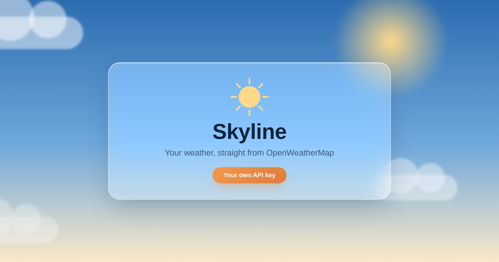

# Skyline — Weather App

A small, static weather app that uses each user's own API key (**BYOK — Bring Your Own Key**) to query [OpenWeatherMap](https://openweathermap.org/) — no account, no backend, no shared key.

**[Live demo →](https://skyline-weatherapp-c67411.netlify.app/)**



**Stack:** HTML5 + CSS3 + vanilla JavaScript, in four plain files (`index.html`, `styles.css`, `logic.js`, `app.js`). No frameworks, no build step, no dependencies to install.

## Why this exists

A weather app is a well-worn exercise, so the interesting part here is the access model: instead of embedding a shared API key (which either leaks or hits rate limits fast), each visitor enters their own free OpenWeatherMap key, stored only in their own browser. There's no server in between and no key ever shared across users — a deliberate trade-off, stated plainly below rather than glossed over.

## Features

- **BYOK login screen** — a centered glassmorphism card (semi-transparent background + `backdrop-filter: blur()`) over an animated, pure-CSS sky (a pulsing sun, drifting clouds via `@keyframes`). The key is validated for presence, saved to `localStorage`, and on refresh the app skips straight to the main screen if a key is already there. A discreet "Change key" button clears it and returns to login.
- **Search form** — city (free text, required) and country (a `<select>` of ISO two-letter codes, optional) — a `<select>` was chosen deliberately over free text for country, to avoid inconsistent input (e.g. "Romania" vs "ROU" vs "RO") breaking the API request.
- **Weather card** — city + country, current temperature (large, prominent), the weather description with the official OpenWeatherMap icon, and a 2×2 grid of feels-like temperature, humidity, wind speed (converted from m/s to km/h plus compass direction), and pressure.
- **Error handling, split explicitly by case:** a network failure gets its own message; a 401 (invalid key) shows a "Re-enter API key" button that clears the key and sends you back to login; a 404 (city not found) says so plainly; any other unexpected status shows a generic message with the status code attached, instead of failing silently.
- **Small interaction details** — a `fade-in-up` entrance animation on the weather card that respects `prefers-reduced-motion`, and the search button disables itself while a request is in flight so a double-click can't fire duplicate requests.

## Design notes

- **Why plain files:** still no bundler and no npm dependencies, and the folder works the same opened locally (`file://`) or hosted anywhere static. The app started as a single `index.html`; the CSS and JavaScript moved into `styles.css` and `app.js` so the Content-Security-Policy can forbid inline scripts and styles.
- **Content-Security-Policy:** sent as a real HTTP header from [`_headers`](_headers). The page may only run its own `app.js`, load fonts from Google Fonts, fetch weather data from `api.openweathermap.org` and show icons from `openweathermap.org`. If someone managed to inject markup (the city name is escaped before it's shown, see `app.js`), an inline script would still be blocked, so it couldn't read the key from `localStorage`.
- **Security model (BYOK), stated plainly:** each user's key lives only in that browser's `localStorage` — isolated per browser/device, with no intermediary server and no key ever shared between users. The trade-off worth naming: the key is visible to anyone with DevTools access on that device, which is an accepted limitation for a prototype/personal project; an app with real users would need to proxy requests through a small backend instead.
- **A debugging note worth keeping:** a weather icon that looked like a plain solid orange circle was initially suspected to be a broken image. Checking the actual network request directly in DevTools (status code, the real rendered `src`) confirmed it was simply OpenWeatherMap's genuine "clear sky" icon (`01d`) — a minimalist design, not a bug. The lesson that carried forward: verify the real request before assuming an unexpected visual is an error.
- **Open Graph preview:** a dedicated `og-preview.png` (1200×630), in the same visual language as the app (sky gradient, glassmorphism card, sun icon), built specifically for the card that appears when the link is shared on WhatsApp, Slack, Discord, Twitter/X, LinkedIn, etc. The `<head>` sets full Open Graph + Twitter Card meta tags, plus an explicit `<meta name="description">` and a longer `<title>` for SEO. The image and URL meta tags use the Netlify domain's **absolute** URL, since social platforms need a complete link to fetch the image — if the site is renamed on Netlify or moved to a custom domain, those three tags need a manual update, or the social preview breaks (the typical symptom, "Failed to fetch image: Not Found", is checkable with [opengraph.xyz](https://www.opengraph.xyz/)).

## Tech stack

Four files, one job each:

| File | Contents |
|---|---|
| `styles.css` | Design tokens in `:root` (colors, fonts, radius), the animated background, the glassmorphism card, forms, the weather card, responsive rules |
| `index.html` | Two screens: `#login-screen` and `#app-screen`, toggled with the `.screen--hidden` class |
| `logic.js` | The pure logic, no page or network: the weather card's values, wind direction, escaping, the request URL, the error message per HTTP status, demo mode's sample data |
| `app.js` | Login/BYOK logic, the search form, the fetch call and rendering |

## Tests

```bash
node --test "tests/*.test.js"
```

16 unit tests for `logic.js`: temperatures rounded and wind converted from m/s to km/h with the right compass point (wrapping around north), missing fields not breaking the card, a city typed as markup shown as text, whatever is typed as the city unable to add parameters to the request, the message for 401 / 404 / other errors, and demo mode's sample data (the same city always gets the same weather). Plain Node, nothing to install, no API key; they run in CI on every push. The page itself (login, search, the card) is checked in a browser, with the requests to OpenWeatherMap answered locally.

## Deploying

Fully static, so deployment is direct:

- **Drag & drop (fastest):** go to [app.netlify.com/drop](https://app.netlify.com/drop) and drop the whole folder (`_headers` included, so the security headers apply) — Netlify generates a public URL automatically.
- **From Git (recommended, for history + auto-redeploy):** connect this repo in Netlify (**Add new site → Import an existing project**). Build settings: no build command needed, publish directory `/`. Netlify redeploys automatically on every push to the main branch.

Once live on a real URL (not `file://`), every visitor sees the login screen and has to enter their **own** OpenWeatherMap key — exactly the BYOK model described above. There is never a key of the project owner's stored in the code or exposed publicly.

## Project structure

```
index.html         — markup: BYOK login screen, app screen, OG meta tags
styles.css         — all the styles
logic.js           — the pure logic (card values, compass, escaping, request URL, errors, demo data)
app.js             — the page side (login, search, fetch, rendering)
tests/             — unit tests for logic.js (node --test)
_headers           — Netlify security headers (CSP, nosniff, framing, referrer)
favicon.svg        — tab icon
og-preview.png     — social-sharing preview image (must be deployed next to index.html)
README.md
```

## License

MIT — see [LICENSE](LICENSE).
